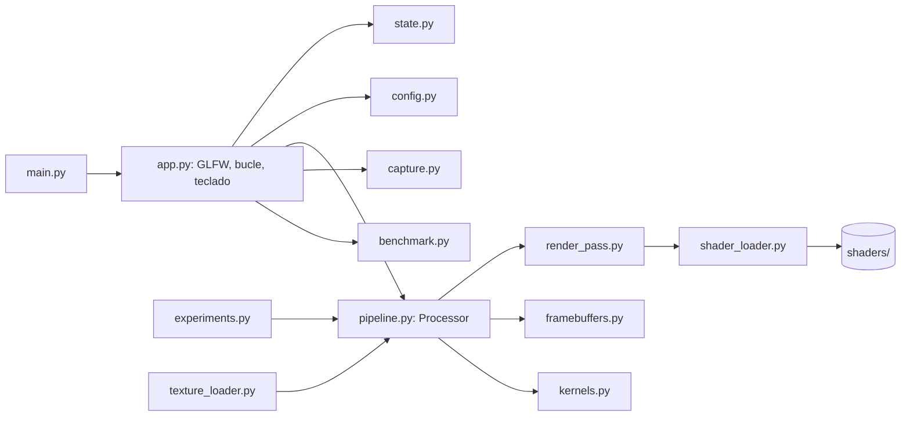
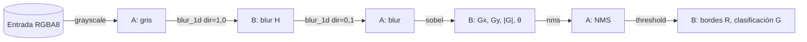

# Diseño técnico: Laboratorio interactivo de máscaras de convolución

Requisitos: #[[file:requirements.md]]

## Estructura de carpetas

```
convolutional_mask/            ← raíz del workspace = raíz del proyecto
├─ main.py                     CLI: --image, --benchmark, --experiments [--quick]
├─ requirements.txt            versiones exactas (runtime)
├─ requirements-dev.txt        -r requirements.txt + pytest
├─ pytest.ini                  testpaths = tests
├─ README.md
├─ config/settings.json        kernel personalizado, σ, α, umbrales, imagen por defecto
├─ assets/images/              imágenes sintéticas + fotos del usuario
├─ shaders/
│  ├─ common.glsl              modos de borde + fetch()
│  ├─ fullscreen.vert
│  ├─ grayscale.frag  convolve3x3.frag  blur_1d.frag  blur_2d.frag
│  ├─ sobel.frag  nms.frag  threshold.frag  unsharp.frag  display.frag
├─ src/
│  ├─ __init__.py
│  ├─ app.py            único módulo que importa glfw: ventana, bucle, teclado
│  ├─ state.py          AppState + handle_key() puro
│  ├─ config.py         carga y validación de settings.json
│  ├─ texture_loader.py
│  ├─ shader_loader.py  #include, compilación, errores legibles
│  ├─ render_pass.py    quad + run_pass()
│  ├─ framebuffers.py   RenderTarget, PingPong
│  ├─ kernels.py        presets, normalización, pesos 1D
│  ├─ pipeline.py       Processor: cadenas de pasadas por modo y etapas
│  ├─ capture.py
│  ├─ benchmark.py
│  └─ experiments.py
├─ tests/               reference.py (numpy), conftest.py (fixture GPU), tests CPU y GPU
├─ tools/make_test_images.py
├─ results/  report/    (con .gitkeep)
└─ .kiro/specs/laboratorio-convolucion/{requirements,design,tasks}.md
```

Cambios respecto a la propuesta original:
- Sin carpeta `convolucion-opengl/` anidada: el workspace ya es el proyecto.
- `common.glsl` garantiza una sola implementación de los 4 modos de borde, compartida por todos los shaders que leen vecinos.
- `blur_2d.frag` es necesario para el módulo D y `unsharp.frag` para el experimento 3.
- `state.py`, `config.py` y `capture.py` separan lógica pura que se puede testear sin GPU.

## Arquitectura



**D1. Núcleo independiente de GLFW.** `Processor`, `run_pass` y `RenderTarget` reciben un `moderngl.Context` y no conocen GLFW. Los tests, el benchmark y `--experiments` reutilizan el mismo código con `moderngl.create_standalone_context(require=330)` (WGL en Windows nativo) o, como respaldo, con una ventana GLFW oculta (`glfw.VISIBLE = False`).

## Flujo de una pasada de render

```mermaid
sequenceDiagram
  participant P as Processor
  participant R as run_pass
  participant GL as GPU
  P->>R: run_pass(prog, target, {u_src: texA}, {u_border:2, u_kernel:[...]})
  R->>R: assert target.texture ∉ entradas
  R->>GL: target.fbo.use(); viewport=(0,0,W,H)
  R->>GL: texA.use(unidad 0); prog["u_src"]=0
  R->>GL: escribir uniforms (omite los que el compilador eliminó)
  R->>GL: vao.render(TRIANGLE_STRIP)  # 4 vértices ±1
  GL->>GL: frag: p = ivec2(gl_FragCoord.xy); por cada offset fetch(u_src, p+off) → remapeo de borde → texelFetch; acumular pesos·valores → out vec4(rgb, 1)
```

- Cada programa tiene su propio VAO sobre un VBO compartido (en moderngl el VAO está ligado al programa).
- moderngl lanza `KeyError` si un uniform fue eliminado por el compilador; `run_pass` comprueba `name in prog` antes de escribir.
- Los arrays de uniforms se escriben con `prog[name].write(np.asarray(values, 'f4').tobytes())`, rellenando con ceros hasta la longitud declarada.
- El tamaño se obtiene en el shader con `textureSize(u_src, 0)`; no hay uniform de resolución.

**D2. Convención de coordenadas.** La textura se sube con los bytes de Pillow tal cual, así que el texel (x, y) es el píxel `img[y, x]`, con y hacia abajo. Los shaders de procesamiento razonan como numpy: el kernel se escribe "como se ve" y los tests comparan sin inversiones. Al escribir en un FBO, el fragmento con `gl_FragCoord = (x+0.5, y+0.5)` corresponde al texel (x, y) del target, así que la convención se mantiene en toda la cadena. El origen abajo-izquierda de la pantalla se resuelve solo en `display.frag`, con `y_tex = H−1−int(gl_FragCoord.y)` cuando `u_flip_y = 1`. La captura dibuja con `u_flip_y = 0` y `fbo.read()` devuelve la fila 0 primero, lista para el PNG. Es un remapeo de índices enteros, como los modos de borde: los vértices nunca cambian y no hay matrices. En los tests, `fbo.read(components=4, dtype='f4')` + `reshape(H, W, 4)` da directamente `img[y, x]`.

## Formatos de textura

| Uso | Formato | Motivo |
|---|---|---|
| Entrada | RGBA8 (`f1`, 4 comp.) | Fila múltiplo de 4, sin problemas de alineación. |
| Intermedias (ping-pong) | RGBA32F (`f4`) | Conserva negativos y valores > 1; renderizable en 3.3 core, sin clamp de salida. RGBA16F rompería la tolerancia de 1e-4. |
| Captura | RGBA8 | Salida de 8 bits para el PNG. |

- Filtro NEAREST (aunque `texelFetch` ignora filtrado y wrap del sampler).
- Memoria: 16·W·H bytes por target f4 (≈33 MB a 1080p). Bastan 2 targets f4 (A, B) más el de captura. Unsharp: el blur termina en A o B y la salida va al otro; la entrada original sigue disponible.
- No se usan los modos de wrap del hardware: `texelFetch` los ignora y `MIRRORED_REPEAT` es "symmetric", no reflect101.
- Los tests de precisión pueden subir la entrada como textura f4; `Processor` acepta cualquier textura de entrada.

## Ping-pong

`PingPong(A, B)` expone `src`, `dst` y `swap()`. La aserción de `run_pass` impide que el destino aparezca entre las entradas. La textura de entrada original es aparte y de solo lectura.



Con S en 2D: gris → `blur_2d` y el resto igual. `Processor.run(state)` ejecuta la cadena hasta la etapa visible y devuelve `(textura, vista)`, donde la vista indica canal, mapeo y ganancia.

| Etapa | Textura y canal | Vista |
|---|---|---|
| 1 Original | entrada, rgb | recorte |
| 2 Gris / 3 Blur H / 4 Blur | r | recorte (en 2D, Blur H muestra el blur completo y el título dice "n/a en 2D") |
| 5 Gx / 6 Gy | sobel r / g | \|v\|, ganancia 0.25 |
| 7 Magnitud | sobel b | ganancia 0.25 (un escalón ideal da \|G\| = 4) |
| 8 Dirección | sobel a, b | tono = θ, brillo = \|G\|·0.25 |
| 9 NMS | nms r | ganancia 0.25 |
| 10 Clasificación / 11 Bordes | threshold g / r | recorte |

**D3. Escala de la magnitud.** |G| de un escalón unidad vale 4 con Sobel. NMS guarda |G| sin escalar y `threshold.frag` compara `m · u_mag_gain` (0.25) con los umbrales. Así el umbral se expresa como fracción de un escalón negro→blanco ideal sin suavizar, independiente de la imagen. La ganancia es fija (0.25) y no se corrige según σ.

Nota: el gaussiano previo atenúa el pico de |G|. Máximo de |G|/4 de un escalón ideal 0→1 tras el desenfoque (referencia numpy):

| σ | 0.5 | 1.0 | 1.4 | 2.0 |
|---|---|---|---|---|
| \|G\|/4 máx. | 0.89 | 0.64 | 0.51 | 0.38 |

En `orientacion.png` (contraste 0.81) el máximo con σ = 1.4 es 0.41. Por eso el umbral alto por defecto es 0.3 (bajo = 0.12): con 0.6 no saldría ningún borde. Al subir σ conviene bajar el umbral con AvPág. Es una limitación conocida que el README documenta.

## Diseño de cada shader

- **`common.glsl`**: se incluye con `#include "common.glsl"`. El loader lo sustituye después de `#version 330 core` e inserta `#line` para que los errores apunten a la línea del archivo original.
  - Expone `uniform int u_border`, `int imod(int a, int n)`, `int reflect_idx(int p, int n)` y `vec4 fetch(sampler2D t, ivec2 p)`.
  - En GLSL 3.30, `%` no está definido con operandos negativos: `imod(a, n) = a − n·int(floor(float(a)/float(n)))`, exacto para |a| < 2²⁴.
  - zero (0): fuera de rango → `vec4(0)`.
  - replicate (1): `clamp(p, 0, n−1)`.
  - reflect (2): si n = 1 → 0; si no, periodo = 2n−2, m = imod(p, periodo), índice = m < n ? m : periodo − m. Funciona con cualquier radio.
  - wrap (3): `imod(p, n)`.
- **`fullscreen.vert`**: `in vec2 in_pos; void main(){ gl_Position = vec4(in_pos, 0.0, 1.0); }`. Sin uniforms.
- **`convolve3x3.frag`**: `uniform float u_kernel[9]`. Acumula `k[r*3+c] · fetch(p + ivec2(c−1, r−1)).rgb`. Array y no `mat3` (R2.3).
- **`blur_1d.frag`**: `uniform ivec2 u_direction`, `uniform int u_radius`, `uniform float u_weights[61]` (índice i+r). Bucle de −r a r sobre rgb; alfa = 1.
- **`blur_2d.frag`**: doble bucle con peso `w[i]·w[j]` sobre el mismo array 1D. Un array de 61² = 3721 pesos superaría el mínimo garantizado de `GL_MAX_FRAGMENT_UNIFORM_COMPONENTS` (1024). Hace (2r+1)² lecturas, que es lo que se mide.
- **`grayscale.frag`**: `dot(rgb, vec3(0.299, 0.587, 0.114))` → (Y, Y, Y, 1).
- **`sobel.frag`**: lee `.r` de los 3x3 vecinos con `fetch` → `vec4(gx, gy, length(vec2(gx, gy)), atan(gy, gx))`. Gx = [−1 0 1; −2 0 2; −1 0 1], Gy = [−1 −2 −1; 0 0 0; 1 2 1] (y hacia abajo).
- **`nms.frag`**: `a = mod(degrees(θ) + 180, 180)`. a < 22.5 o a ≥ 157.5 → vecinos (±1, 0); a < 67.5 → (1, 1)/(−1, −1); a < 112.5 → (0, ±1); si no → (−1, 1)/(1, −1). Conserva m si `m ≥ n1 && m > n2` (desigualdad asimétrica para evitar líneas dobles en mesetas); si no, 0. Salida (m, m, m, 1).
- **`threshold.frag`**: `u_low`, `u_high`, `u_mag_gain` (no `u_mag_scale`: `test_constraints.py` prohíbe "scale" en nombres de uniforms para detectar transformaciones). Fuerte si v ≥ alto; débil si bajo ≤ v < alto; el débil se promueve si alguno de sus 8 vecinos (vía `fetch`) es fuerte. Salida R = borde (0/1), G = clasificación (0 / 0.5 / 1), B = R, A = 1.
- **`unsharp.frag`**: `u_src`, `u_blur`, `u_alpha` → `src + α·(src − blur)`.
- **`display.frag`**: `u_channel` (0 rgb, 1 r, 2 g, 3 b, 4 dirección), `u_map` (0 recorte, 1 abs, 2 offset), `u_gain`, `u_flip_y`. Dirección: hsv→rgb con tono = (θ+π)/2π y valor = clamp(|G|·ganancia). Salida recortada a [0, 1], alfa 1, lectura con `texelFetch`.

## Presets (`kernels.py`, sin normalizar)

| Tecla | Kernel | Pesos (fila superior primero) | Suma | Vista |
|---|---|---|---|---|
| 1 | Identidad | 0 0 0 / 0 1 0 / 0 0 0 | 1 | recorte |
| 2 | Box | 1 1 1 / 1 1 1 / 1 1 1 | 9 | recorte |
| 3 | Gaussiano | 1 2 1 / 2 4 2 / 1 2 1 | 16 | recorte |
| 4 | Sharpen | 0 −1 0 / −1 5 −1 / 0 −1 0 | 1 | recorte |
| 5 | Sobel Gx | −1 0 1 / −2 0 2 / −1 0 1 | 0 | abs |
| 6 | Sobel Gy | −1 −2 −1 / 0 0 0 / 1 2 1 | 0 | abs |
| 7 | Laplaciano | 0 1 0 / 1 −4 1 / 0 1 0 | 0 | abs |
| 8 | Emboss | −2 −1 0 / −1 1 1 / 0 1 2 | 1 | recorte |
| 0 | Personalizado | `settings.json` | — | recorte |

Pesos 1D: gaussiano `w_i = exp(−i²/2σ²)` normalizado, r = ceil(3σ); box `1/(2r+1)`, r = round(√3·σ). `MAX_TAPS = 61` se define en Python y en los shaders; un test verifica que coinciden.

## settings.json (valores por defecto)

```json
{
  "default_image": "assets/images/orientacion.png",
  "custom_kernel": [[0, -1, 0], [-1, 5, -1], [0, -1, 0]],
  "sigma": 2.0,
  "canny_sigma": 1.4,
  "alpha": 1.0,
  "canny_high": 0.3,
  "canny_low_ratio": 0.4
}
```

## Estado, teclas y bucle

`AppState` (dataclass): mode (kernel/blur/unsharp/canny), kernel_id, custom_kernel, normalize, display_map, border, sigma, canny_sigma, profile (gauss/box), separable, alpha, canny_on, prev_mode, stage, high, low_ratio, dirty. `handle_key(state, key) → (state, acción)` es pura; acciones: None, "capture", "benchmark", "reload", "help", "quit". Las teclas se representan con constantes propias en `state.py` (sin importar glfw); `app.py` traduce los códigos de GLFW.

| Tecla | Acción |
|---|---|
| 1–8, 0 | kernel preset / personalizado (modo Kernel) |
| B | modo de borde |
| N | normalización |
| V | mapeo de visualización |
| R | recargar `settings.json` |
| M | modo Kernel → Desenfoque → Unsharp |
| X | perfil gauss / box |
| Arriba / Abajo | σ (en Canny ajusta canny_sigma) |
| RePág / AvPág | α (Unsharp) o umbral alto (Canny) |
| S | 2D directo / separable |
| C | Canny on/off |
| Izquierda / Derecha | etapa de Canny |
| G | captura |
| P | benchmark |
| H | ayuda |
| Esc | salir |

Las flechas y RePág/AvPág responden también a REPEAT.

```
while not should_close:
    glfw.wait_events_timeout(0.25)   # no gasta CPU/GPU; permite vigilar el mtime
    si kernel personalizado y cambió el mtime → recargar
    si dirty: con query de tiempo → processor.run(state); display a pantalla; swap; título
```

`set_window_refresh_callback` marca `dirty` (sin él, Windows deja la ventana en negro tras minimizar o tapar). Antes de dibujar a pantalla: `ctx.screen.use()` y viewport (0, 0, W, H). `glfw.set_error_callback` registra los errores de GLFW.

## Benchmark

Para cada σ ∈ {1, 2, 3, 5, 8, 10} y cada método (2D o separable): 5 ejecuciones de calentamiento y 50 medidas. Cada medida usa su propia `ctx.query(time=True)` alrededor de las pasadas de desenfoque y lee `q.elapsed` (ns). Las consultas no se anidan.

Columnas del CSV: fecha, gpu, W, H, borde, sigma, r, metodo, lecturas_px, media_ms, mediana_ms, desv_ms, min_ms, aceleracion (2D/separable).

Nota para el informe: la aceleración medida será menor que la teórica, (2r+1)/2, por la caché de texturas. Conviene medir con el portátil enchufado y el perfil de alto rendimiento.

## Experimentos (`--experiments`)

- E1: 4 bordes × {gauss σ = 8, Laplaciano, Sobel Gx}.
- E2: gauss y box de varianza equivalente con σ ∈ {1, 2, 4, 8}.
- E3: sharpen (preset 4) frente a unsharp con α ∈ {0.5, 1, 2} y σ ∈ {1, 2}.
- E4: CSV del benchmark (`--quick` reduce repeticiones).
- E5: Sobel Gx, Gy (modo Kernel, presets 5/6) sin suavizado frente a las 11 etapas de Canny.

Salida en `results/experimentos_<fecha>/` con `manifest.csv` (archivo, experimento, modo, kernel/etapa, borde, sigma, perfil, alfa, umbrales, método).

## Manejo de errores

| Situación | Detección | Respuesta | Código |
|---|---|---|---|
| Imagen inexistente, ilegible o no válida | `Path.exists`, `UnidentifiedImageError`, `OSError` | ruta, motivo y lista de `assets/images` | 2 |
| Imagen > `GL_MAX_TEXTURE_SIZE` | tras crear el contexto | mensaje | 2 |
| GLFW no inicia, ventana no creada o GL < 3.3 | `glfw.init()`, `None`, `version_code` | mensaje con causas (driver, RDP, adaptador básico) | 3 |
| Error de compilación o enlace de shader | `moderngl.Error` al arrancar | archivo, log y líneas corregidas con `#line` | 4 |
| `settings.json` inválido | `JSONDecodeError` / validación | conserva la configuración previa y muestra el error | — |
| Consultas de tiempo no disponibles | excepción | aviso, continúa sin tiempos | — |
| Fallo al escribir la captura | `OSError` | mensaje, continúa | — |
| Ventana minimizada (framebuffer 0×0) | `get_framebuffer_size` | no dibuja | — |
| Excepción inesperada / Ctrl+C | manejador de nivel superior | `release()` en orden inverso y `glfw.terminate()` en `finally` | 1 / 130 |

## Estrategia de pruebas

- CPU: kernels, normalización, pesos 1D, `handle_key`, validación de configuración, nombres de captura, índices de borde de referencia.
- GPU: fixture `ctx` en `conftest.py` con `moderngl.create_standalone_context(require=330)` (respaldo: ventana GLFW oculta); si falla, `pytest.skip("sin contexto OpenGL 3.3: ...")`. Comparación con `tests/reference.py` (correlación con `np.pad`). Imágenes de tamaño impar y no cuadradas (7×5) con valores float aleatorios con semilla, para detectar ejes intercambiados.
